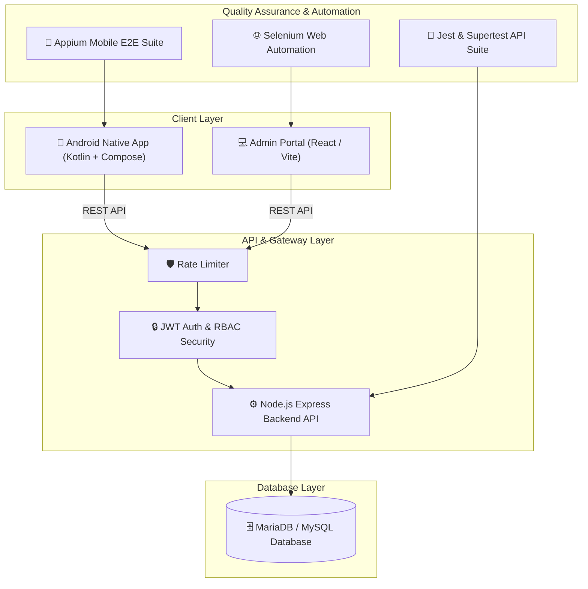

# AgriFarm — Enterprise Smart Agriculture Platform

[](https://github.com/Sateesh567/agrifarm/actions/workflows/android-ci.yml)
[](https://github.com/Sateesh567/agrifarm/actions/workflows/backend-ci.yml)
[](https://github.com/Sateesh567/agrifarm/actions/workflows/admin-ci.yml)
[](https://github.com/Sateesh567/agrifarm/actions/workflows/security-scan.yml)
[](LICENSE)

**AgriFarm** is an enterprise-grade digital agriculture ecosystem connecting farmers, organic shop merchants, and agricultural administrators. It comprises a native Android application (Kotlin + Jetpack Compose), a React/Vite Admin Management Portal, a Node.js Express backend, a MariaDB database, and comprehensive automated test suites (Selenium, Appium, Supertest, Jest).

---

## 🏛️ System Architecture



---

## 📂 Project Repository Structure

```
agrifarm/
├── app/                      # Android Native Application (Kotlin + Jetpack Compose)
├── admin-portal/             # React/Vite Web Portal & Selenium Web Automation
│   └── selenium-tests/       # Selenium Web Automation Test Suite
├── backend-server/           # Node.js + Express REST API Server
│   └── backend-tests/        # Integration, Unit, API, & Load Performance Tests
├── appium-test/              # Appium Mobile Automation Test Suite
├── database/                 # Centralized MariaDB / MySQL Schema & Seed Data
│   ├── schema.sql            # Enterprise Database DDL Schema
│   └── seed.js               # Database Seeding Script
├── docs/                     # System Architecture & Technical Specifications
│   └── ARCHITECTURE.md       # Architectural Design Document
├── .github/
│   ├── workflows/            # Enterprise CI/CD Pipeline Workflows
│   │   ├── android-ci.yml    # Android Native Build & Lint CI
│   │   ├── frontend-ci.yml   # Frontend Web CI
│   │   ├── admin-ci.yml      # Admin Dashboard CI
│   │   ├── backend-ci.yml    # Backend API CI & Integration Tests
│   │   ├── selenium-tests.yml# Selenium Web Automation Pipeline
│   │   ├── appium-tests.yml  # Appium Mobile Automation Pipeline
│   │   ├── api-tests.yml     # API Testing & Coverage Pipeline
│   │   ├── security-scan.yml # CodeQL & Vulnerability Audit Pipeline
│   │   └── performance-tests.yml # Performance & Load Testing Pipeline
│   ├── ISSUE_TEMPLATE/       # GitHub Issue Templates
│   ├── dependabot.yml        # Dependabot Dependency Security Scanner
│   └── pull_request_template.md
├── .gitignore                # Multi-tier Git Ignore Policies
├── .env.example              # Root Environment Template
├── README.md                 # Master Documentation
├── CONTRIBUTING.md           # Development & Contribution Guidelines
├── SECURITY.md               # Enterprise Security Policy
└── LICENSE                   # MIT Open Source License
```

---

## 🛠️ Environment Configuration & Variables

Prior to running the system, create copy `.env.example` to `.env` in the required modules:

| Variable Key | Description | Default / Example |
| ------------ | ----------- | ----------------- |
| `PORT` | Backend HTTP API Server Port | `3000` |
| `DB_HOST` | MariaDB / MySQL Database Host | `127.0.0.1` |
| `DB_PORT` | MariaDB / MySQL Database Port | `3306` |
| `DB_USER` | Database User Name | `root` |
| `DB_PASSWORD` | Database User Password | `your_db_password` |
| `DB_NAME` | Database Name | `agrifarm` |
| `JWT_ACCESS_SECRET` | Secret key for access tokens | *64+ char random string* |
| `JWT_REFRESH_SECRET` | Secret key for refresh tokens | *64+ char random string* |
| `VITE_API_BASE_URL` | Admin Portal API Endpoint | `http://localhost:3000/api` |

---

## 🚀 Quick Start & Installation

### 1. Database Setup (MariaDB / MySQL)
```bash
mysql -u root -p < database/schema.sql
```

### 2. Backend API Setup
```bash
cd backend-server
cp .env.example .env
npm install
node seed.js
npm start
```
The REST API server will run on `http://localhost:3000`.

### 3. Admin Portal Web Setup
```bash
cd admin-portal
cp .env.example .env
npm install
npm run dev
```
The Admin Portal will run on `http://localhost:5173`.

### 4. Android Mobile Application Setup
- Open [app](file:///c:/Users/Boyapati%20Aswini/AndroidStudioProjects/agrifarm/app) in **Android Studio Hedgehog** (or newer).
- Sync Gradle dependencies.
- Run on Android Emulator (API 26+) or physical device.

---

## 🧪 Running Automated Test Suites

### API & Backend Tests (Jest + Supertest)
```bash
cd backend-server/backend-tests
npm install
npm test
```

### Web UI Automation Tests (Selenium WebDriver)
```bash
cd admin-portal/selenium-tests
npm install
npm test
```

### Mobile UI Automation Tests (Appium)
```bash
cd appium-test
npm install
npm test
```

---

## 🛡️ Enterprise Quality Gates & CI/CD Pipeline

The GitHub Actions workflows enforce strict enterprise quality gates:
1. **Compilation Gate**: Android Gradle build and Vite production build must complete cleanly.
2. **Test Gate**: All Unit, Integration, and Automation tests must pass.
3. **Coverage Gate**: Test coverage report threshold of 80%+.
4. **Security Gate**: CodeQL analysis, secret scanning (TruffleHog), and `npm audit` with 0 high/critical vulnerabilities.
5. **Linting Gate**: Zero Android Lint errors and ESLint cleanliness.

---

## 📦 Git & GitHub Deployment Commands

To commit and push all enterprise updates to GitHub:

```bash
git init
git add .
git commit -m "Initial AgriFarm commit: Enterprise CI/CD, security hardening & full repository setup"
git branch -M main
git remote add origin https://github.com/Sateesh567/agrifarm.git
git push -u origin main
```
