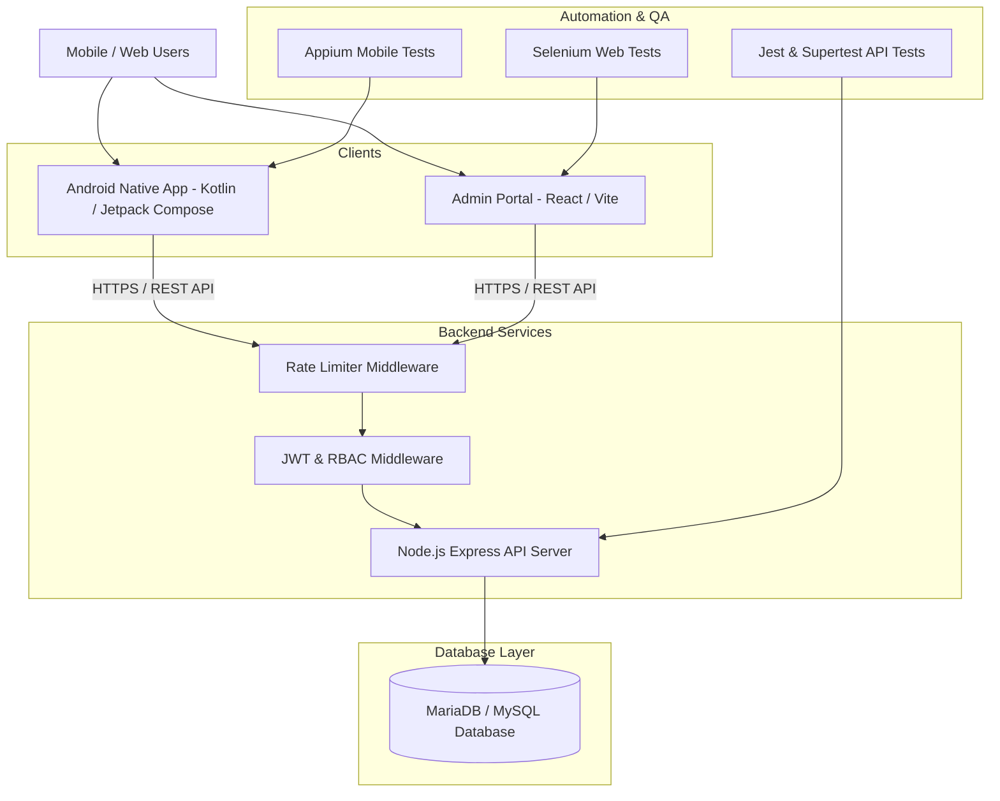

# AgriFarm Enterprise System Architecture

## System Components

1. **Android Native App (`/app`)**:
   - Built with **Kotlin** and **Jetpack Compose**
   - Implements farmer search, crop scanner, MANDI price index, shopping cart, and order tracking
   - Communicates with Node.js Express backend API

2. **Admin Portal (`/admin-portal`)**:
   - Built with **React** + **Vite** + **Tailwind CSS**
   - Provides administrative controls: user management, shop approval, product moderation, order auditing, and system logs

3. **Backend API (`/backend-server`)**:
   - **Node.js** + **Express** server
   - Authentication via **JWT tokens** with refresh token blacklisting & RBAC
   - Input validation, security headers (Helmet), CORS controls, rate limiting, and central error handling

4. **Database (`/database`)**:
   - **MariaDB / MySQL** relational schema
   - Normalized tables with foreign key constraints, indexing on lookup fields, and soft deletes (`deleted_at`)

5. **QA & Automated Testing (`/appium-test`, `/admin-portal/selenium-tests`, `/backend-server/backend-tests`)**:
   - **Appium**: Mobile UI automation testing across device flows
   - **Selenium**: Web UI testing for admin portal dashboard workflows
   - **Jest + Supertest**: End-to-end API integration & unit test suite
